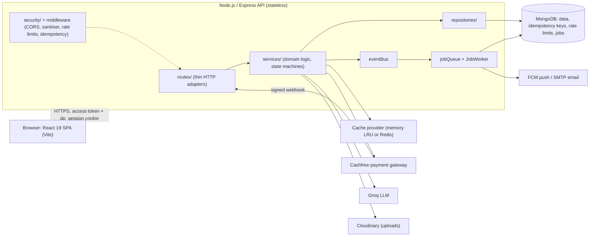

# DrivePortz (Mobility Digital Twin)

A vehicle "digital twin" and garage marketplace: owners keep a verifiable history of each vehicle, book garages and pay online, while garages and admins run invoicing, earnings, settlements and reconciliation on the same platform.

[](https://github.com/suriyaprakash-25/Digital-Twin/actions/workflows/ci.yml)


## Overview

Used-vehicle buyers in India rarely get a trustworthy service history, and small garages rarely have proper booking, GST billing or payout tooling. DrivePortz addresses both sides:

- **Vehicle owners** register their vehicles and get a digital record (the "vehicle passport") of services, ownership transfers, insurance and health. They can find a garage, book a slot, pay online and download a GST invoice.
- **Garages** manage their profile, service catalogue and availability, accept and complete bookings, issue invoices and track earnings, settlements and tax.
- **Admins** oversee payments, reconciliation, disputes, risk, treasury and settlement approvals.

The project is a full-stack application (React SPA + Node/Express API + MongoDB) that is set up for a controlled pilot: deployment configs exist for Render and Vercel, and money-moving features ship with safe defaults (mock settlements, scheduled financial jobs off). Detailed design notes are in [ARCHITECTURE.md](ARCHITECTURE.md).

## Key features

**Vehicle digital twin (owners)**
- Vehicle registry with add/edit, service history and verified service records logged by garages.
- Vehicle passport (JSON and PDF) with a public, allow-listed view for sharing with buyers ([`routes/passport.js`](backend/src/routes/passport.js)).
- Rule-based vehicle health score and condition level from service history, insurance status and repairs ([`utils/healthCalc.js`](backend/src/utils/healthCalc.js), [`routes/health.js`](backend/src/routes/health.js)).
- Resale report: depreciation from purchase price and age, adjusted by a trust score (owner count, verified services, accident records) ([`routes/resale.js`](backend/src/routes/resale.js)).
- Service reminders, insurance records and ownership transfer (request, accept, reject, cancel, history) driven by a state machine.

**Garage marketplace**
- Garage discovery and marketplace listing, garage reviews, slot availability with per-garage capacity guard.
- Booking lifecycle with an explicit state machine (`services/bookings/bookingStateMachine.js`).
- GST invoices with tax snapshots, credit notes, earnings ledger, settlement requests and payout profiles.

**Payments and finance**
- Cashfree checkout (primary gateway) behind a `PaymentGateway` interface; Razorpay kept for legacy records; a deterministic mock gateway for tests (refused in production).
- Payment capture via both server-side verify and HMAC-signed webhooks, reconciled through a single compare-and-swap capture so exactly one path wins.
- Refunds, disputes, reconciliation against gateway records, treasury, tax reports, audit log, risk events, financial alerts and an integrity scanner.
- Maker-checker settlement approval with dual approval for high-value payouts; idempotency keys required on admin settlement actions.

**AI assistants (Groq)**
- Vehicle Doctor: diagnoses a complaint (text plus up to several images) against the vehicle's recent services and returns causes, urgency and cost range ([`services/aiDoctorAgent.js`](backend/src/services/aiDoctorAgent.js)). The UI flag `AI_DOCTOR` is currently `false` in [`frontend/src/config/features.js`](frontend/src/config/features.js).
- CoPilot chat assistant with intent routing to platform, marketplace, emergency and knowledge-base agents.

**Platform**
- JWT auth with an httpOnly session cookie plus a short-lived in-memory access token, `tokenVersion` revocation, hashed OTPs, Google sign-in.
- Roles `USER`, `GARAGE`, `ADMIN` with resource-level policies (e.g. garages only see vehicles they have serviced).
- Push notifications (Firebase Cloud Messaging), email (SMTP via Nodemailer, mock provider in dev/CI), media uploads to Cloudinary.

## Architecture



| Component | Role |
|---|---|
| Frontend ([`frontend/`](frontend)) | React 19 SPA with three route trees (public, owner/garage, admin). All HTTP goes through [`src/utils/api.js`](frontend/src/utils/api.js); pages are lazy-loaded. |
| API composition root ([`backend/server.js`](backend/server.js)) | Wires middleware (correlation id, monitoring, security headers, CORS allowlist, size-aware JSON parser, Mongo-operator sanitiser), mounts the `ROUTES` table, creates indexes and starts the job worker. |
| `routes/` -> `services/` -> `repositories/` | Layered modular monolith: routes validate and authorise, services hold business rules and compare-and-swap state machines, repositories own all database access. |
| `infrastructure/` | Cache provider, event bus, MongoDB-backed durable job queue (leases, retries, dead-letter), resilient HTTP (timeouts and circuit breakers), distributed rate limiters. |
| MongoDB | System of record, plus idempotency keys, rate-limit counters and job leases so API instances stay stateless. |
| External services | Cashfree (payments), Groq (AI), Cloudinary (media), Firebase Admin (push), SMTP (email). |

## How it works

The critical path is a service booking that ends in an online payment:

1. The owner picks a garage from the marketplace and books a slot. The booking service checks capacity under a per-garage lease and creates the booking in `REQUESTED` state.
2. The garage accepts and completes the job through the booking state machine, logging the service record (which feeds the vehicle passport and health score) and finalising a GST invoice.
3. The owner pays: `POST /api/payments/create-order` passes the rate limiter and idempotency reservation, reads the amount from the invoice in the database (never from the client) and creates a Cashfree order.
4. After checkout, confirmation arrives on two paths: `POST /api/payments/verify` (server re-verifies with Cashfree) and the Cashfree webhook (HMAC signature, timestamp, deduplicated event id). Both call one capture function whose compare-and-swap moves the payment to `CAPTURED` exactly once and marks the invoice `PAID` or `PARTIALLY_PAID`.
5. The earnings row is written idempotently, a `payment.captured` event is published, and a durable job sends push and in-app notifications with retries.
6. Later, the garage requests a settlement; earnings rows are locked atomically, an admin approves (dual approval above a threshold), and the payout is claimed `APPROVED -> PROCESSING` before the payout provider (mock by default) is called. Reconciliation compares the ledger with gateway records.

## Tech stack

| Layer | Technologies |
|---|---|
| Frontend | React 19, Vite 7, Tailwind CSS 4, React Router 7, Framer Motion, Recharts, Leaflet, three.js / React Three Fiber (landing 3D model), Firebase (web push) |
| Backend | Node.js 22, Express 4 (CommonJS), MongoDB native driver 6, JSON Web Tokens, bcryptjs, Luxon, Multer, PDFKit, QRCode, ExcelJS |
| Integrations | Cashfree PG, Razorpay (legacy), Groq SDK, Cloudinary, Firebase Admin, Nodemailer |
| Testing | Plain Node `assert` suites against a real MongoDB (backend), Vitest + Testing Library (frontend), Playwright (browser smoke and end-to-end journey) |
| CI/CD | GitHub Actions ([`ci.yml`](.github/workflows/ci.yml), [`production-smoke.yml`](.github/workflows/production-smoke.yml)), supply-chain guard script, Render ([`render.yaml`](render.yaml)) for the API, Vercel for the SPA |

## Project structure

```text
Digital-Twin/
├── backend/
│   ├── server.js                # Composition root: middleware, ROUTES table, indexes, job worker
│   ├── src/
│   │   ├── routes/              # HTTP adapters (vehicles, bookings, payments, admin, ...)
│   │   ├── services/            # Domain logic: bookings, payments, invoices, earnings, disputes, AI agents
│   │   ├── repositories/        # BaseRepository + per-entity repositories
│   │   ├── models/              # Collection index definitions
│   │   ├── infrastructure/      # Cache, event bus, job queue, resilient HTTP, rate limiters
│   │   ├── security/            # CORS policy, HTTP hardening, vehicle and payment access policies
│   │   ├── middleware/          # Auth, admin/permission guards, idempotency, monitoring
│   │   ├── core/                # Constants, typed errors, pagination, transactions
│   │   └── jobs/                # Settlement and financial operations scheduler
│   ├── scripts/                 # Admin and pilot seeding, data migrations, e2e seed
│   ├── test_*.js                # Backend verification suites (run by npm test)
│   └── .env.example             # Backend configuration template
├── frontend/
│   ├── src/
│   │   ├── pages/               # Owner, garage and admin pages (pages/admin/*)
│   │   ├── components/          # UI grouped by domain (payment, settlement, copilot, garage, ...)
│   │   ├── context/, hooks/     # Auth context, data-fetching and checkout hooks
│   │   └── utils/api.js         # The single HTTP gateway to the backend
│   ├── tests/                   # Playwright smoke and e2e journey
│   └── .env.example             # Frontend configuration template
├── docs/pilot/                  # Customer, garage, admin and support guides
├── scripts/                     # Supply-chain guard, production deployment verifier
├── ARCHITECTURE.md              # 12-step high-level design walkthrough
└── render.yaml                  # Render service definition
```

## Getting started

### Prerequisites

- Node.js 22.x
- MongoDB 7 (local or Atlas). A replica set is needed for multi-document transactions; standalone works for development.
- Optional: Redis, Cashfree sandbox credentials, Groq API key, Cloudinary and Firebase projects for the related features.

### Installation

The backend and frontend are independent npm projects. The repository's CI runs the supply-chain guard before installing, and it is a good habit locally too:

```bash
git clone https://github.com/suriyaprakash-25/Digital-Twin.git
cd Digital-Twin
node scripts/supply-chain-guard.mjs

cd backend && cp .env.example .env && npm install
cd ../frontend && cp .env.example .env && npm install
```

### Environment variables

Backend ([`backend/.env.example`](backend/.env.example)), main groups:

| Variables | Purpose |
|---|---|
| `PORT`, `NODE_ENV`, `ENFORCE_PRODUCTION_READINESS` | Server and environment validation (production/staging fail fast on invalid config) |
| `MONGO_URI`, `MONGO_DB_NAME` | Database connection |
| `JWT_SECRET_KEY` (required), `JWT_EXPIRES_IN` | Token signing |
| `FRONTEND_URL`, `CORS_ALLOWED_ORIGINS` | CORS allowlist |
| `CASHFREE_APP_ID`, `CASHFREE_SECRET_KEY`, `CASHFREE_ENV`, `CASHFREE_API_VERSION` | Payment gateway |
| `SETTLEMENT_MODE`, `SETTLEMENT_PROVIDER`, `FINANCIAL_JOBS_ENABLED`, `MIN_SETTLEMENT_AMOUNT`, `HIGH_VALUE_SETTLEMENT_THRESHOLD`, ... | Settlement behaviour and thresholds |
| `PLATFORM_COMMISSION_RATE`, `PLATFORM_COMMISSION_TYPE` | Platform commission |
| `PAYMENT_RISK_ENABLED`, `PAYMENT_MAX_ATTEMPTS_PER_INVOICE`, `DISPUTE_RISK_THRESHOLD`, ... | Risk rules |
| `EMAIL_PROVIDER`, `SMTP_HOST`, `SMTP_PORT`, `SMTP_USER`, `SMTP_PASS`, `SMTP_FROM_EMAIL` | Email delivery |
| `GROQ_API_KEY`, `GEMINI_API_KEY` | AI features |
| `GOOGLE_CLIENT_ID`, `GOOGLE_MAPS_API_KEY` | Google sign-in and maps |
| `CLOUDINARY_CLOUD_NAME`, `CLOUDINARY_API_KEY`, `CLOUDINARY_API_SECRET` | Media storage |
| `FIREBASE_SERVICE_ACCOUNT_PATH` | Firebase Admin (push notifications) |

Frontend ([`frontend/.env.example`](frontend/.env.example)): `VITE_API_URL` (backend origin, without `/api`), `VITE_FIREBASE_*` (web push), `VITE_GOOGLE_CLIENT_ID`, `VITE_CASHFREE_APP_ID`, `VITE_CASHFREE_MODE`.

### Run

```bash
# Terminal 1: API on http://localhost:5000
cd backend
npm run dev

# Terminal 2: SPA on http://localhost:5173
cd frontend
npm run dev
```

Create an admin account with [`backend/scripts/seed-admin.js`](backend/scripts/seed-admin.js) (`node scripts/seed-admin.js` from `backend/`), and pilot test accounts with `npm run pilot:seed`.

### Tests

```bash
# Backend: chained Node assert suites; needs a running MongoDB
cd backend
npm test                       # full CI chain
npm run test:payment-security  # or any single test:<name> script in package.json

# Frontend
cd frontend
npm test                       # Vitest
npm run lint
npm run build:production       # validates required env vars, then builds

# Browser end-to-end journey (owner books -> garage completes -> owner pays)
npx playwright test --config playwright.e2e.config.js --project e2e
```

Playwright is intentionally not in `package.json`; CI installs it with `npm install --no-save @playwright/test@1.55.0`.

## API overview

All routes are mounted in [`backend/server.js`](backend/server.js) under `/api`. Many domains have role-scoped variants (for example `/api/disputes`, `/api/garage/disputes`, `/api/admin/disputes`).

| Area | Prefixes |
|---|---|
| Auth and session | `/api/auth` (login, signup, Google sign-in, OTP password reset, `GET /session`, `POST /logout`) |
| Vehicle twin | `/api/vehicles`, `/api/services`, `/api/vehicle-health`, `/api/resale`, `/api/reminders`, `/api/insurance`, `/api/passport`, `/api/ownership` |
| Marketplace | `/api/marketplace`, `/api/garages`, `/api/garage`, `/api/garage/availability`, `/api/bookings` |
| Money | `/api/payments`, `/api/invoices`, `/api/garage/earnings`, `/api/garage/tax`, `/api/disputes` |
| Admin | `/api/admin`, `/api/admin/settlements`, `/api/admin/reconciliation`, `/api/admin/treasury`, `/api/admin/risk`, `/api/admin/alerts`, `/api/admin/monitoring`, `/api/admin/pilot` |
| AI | `/api/vehicle-doctor` (`POST /analyze`, `GET /history`), `/api/copilot` (`POST /chat`, `POST /emergency`) |
| Ops | `/api/health/ready` (readiness probe), `/api/notifications`, `/api/media` |

List endpoints accept `?page=&limit=` (default 50, max 200) and return totals in `X-Total-Count`, `X-Page`, `X-Limit` and `X-Total-Pages` headers.

## Limitations and roadmap

- **Pilot stage.** Garage settlements run in mock mode (`SETTLEMENT_MODE=MOCK_TEST_MODE`, `SETTLEMENT_PROVIDER=mock`) and scheduled financial jobs are disabled in [`render.yaml`](render.yaml) until the steps in [GO_LIVE_CHECKLIST.md](GO_LIVE_CHECKLIST.md) and [PILOT_FINANCIAL_POLICY.md](PILOT_FINANCIAL_POLICY.md) are completed.
- **AI Doctor** is implemented in the backend but hidden in the UI (`AI_DOCTOR: false`). AI output is LLM-generated advice, not a certified diagnosis.
- **Health score and resale value** are heuristic, rule-based calculations, not trained models.
- "Digital twin" here means a data record of the vehicle's life (services, ownership, insurance, condition); there is no live telematics or OBD integration.
- Multi-document transactions only run on a replica set or Atlas; on standalone MongoDB safety relies on compare-and-swap updates and unique indexes.
- Known next steps from [ARCHITECTURE.md](ARCHITECTURE.md): shrink the three.js landing chunk, add cursor pagination to per-user admin listings.
- `backend/scratch/` and the `audit_*.js` scripts are one-off tooling, not part of the app.

## Further documentation

- [ARCHITECTURE.md](ARCHITECTURE.md): requirements, scale assumptions, data flow, failure handling, security, trade-offs
- [PRODUCTION_DEPLOYMENT.md](PRODUCTION_DEPLOYMENT.md), [DISASTER_RECOVERY.md](DISASTER_RECOVERY.md), [GO_LIVE_CHECKLIST.md](GO_LIVE_CHECKLIST.md)
- [PAYMENT_SETUP.md](PAYMENT_SETUP.md) and the `PAYMENT_PHASE*.md` / `PHASE*_SETUP.md` design notes
- [docs/pilot/](docs/pilot): customer, garage, admin and support guides

## Author

Built by [Suriyaprakash](https://github.com/suriyaprakash-25).

Copyright (c) 2026 DrivePortz. All rights reserved. No open-source license is granted.
